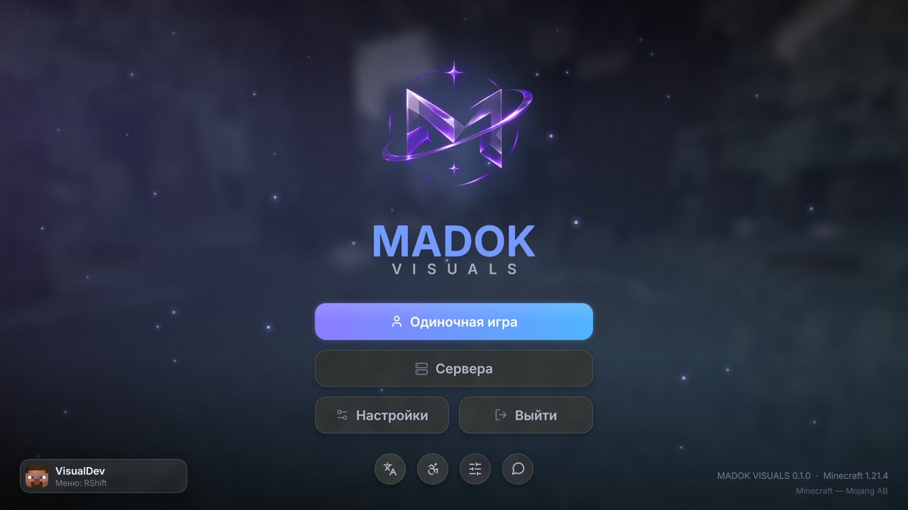

# MADOK VISUALS

Визуальный клиент для Minecraft 1.21.4 без читов. by MaDi75

**[⬇ Скачать для Windows](https://github.com/MaDi75/madok-visuals/releases/latest)** · **[Discord](https://discord.gg/bKyR34QjF4)**

## Что внутри

- **Своё меню клиента:** одно окно, поиск, темы, HUD-редактор.
- **HUD:** ArrayList, TargetHUD, Dynamic Island, Keystrokes, броня, эффекты, бинды.
- **Визуалы:** метка цели, круги прыжков, шлейфы, частицы, прицел, хитбоксы, траектории, зум.
- **Косметика:** ушки, крылья, нимб, плащ. Видишь их только ты.
- **Мелочи:** чат-бинды, обмен конфигами одним кодом, статус в Discord.
- **FPS:** Sodium в комплекте, Iris для шейдеров по желанию.

Никаких читов: только картинка и удобство.

## Как установить

1. Скачай `MADOK-VISUALS-Setup-x.y.z.exe` из [последнего релиза](https://github.com/MaDi75/madok-visuals/releases/latest).
2. Запусти и пройди установку. Ярлык появится на рабочем столе.
3. В лаунчере добавь ник и нажми «Играть». Игру, Java и моды лаунчер скачает сам.

Обновления лаунчер находит и ставит сам, ничего перекачивать не нужно.

Windows может показать предупреждение SmartScreen, потому что у установщика нет платной подписи. Нажми «Подробнее» → «Выполнить в любом случае».

## Помощь

Баги и идеи пиши в [Discord](https://discord.gg/bKyR34QjF4), канал #баги. Если игра вылетела, лаунчер сам предложит скопировать отчёт.

---

© 2026 MaDi75. Все права защищены. Minecraft — товарный знак Mojang AB; проект не связан с Mojang и Microsoft.
