

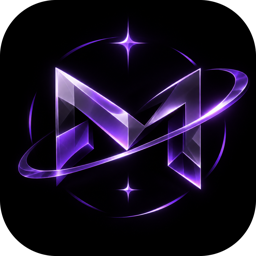

# MADOK VISUALS

Визуальный клиент для Minecraft Java 1.21.4.

**[Скачать для Windows](https://github.com/MaDi75/madok-visuals/releases/latest)** · **[Discord](https://discord.gg/bKyR34QjF4)**

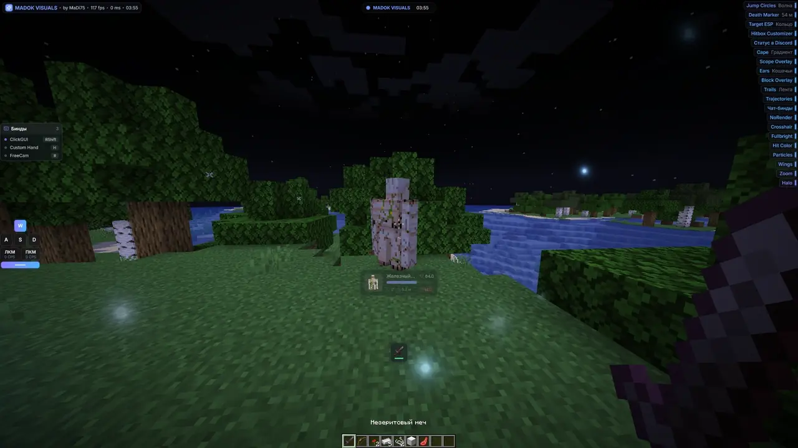

## Почему MADOK VISUALS

**Плавно.** Ничего не появляется рывком: меню, переключатели, карточки, скролл и HUD двигаются на пружинах и плавных кривых. Под стеклом настоящее размытие (dual Kawase), шрифты векторные (SDF) и остаются чёткими на любом разрешении и масштабе.

**Быстро.** Весь HUD рисуется одной пачкой. На тестовом ПК со всеми модулями сразу было ~315 FPS, после оптимизации стало ~420. Sodium идёт в комплекте, Iris для шейдеров включается одной галочкой.

**В одном стиле.** Главное меню, сервера, одиночные миры, пауза и экраны загрузки нарисованы заново и выглядят как одно целое. 5 тем, и тема меняется сразу везде.

**Под себя.** У каждого эффекта есть цвет, размер и режим, HUD двигается мышью, а настройками можно поделиться одним кодом.

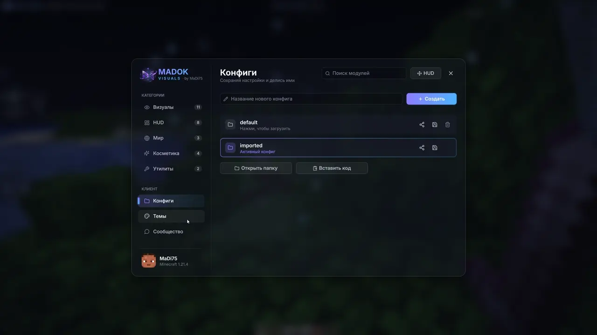

## Что это

MADOK VISUALS — мод для Fabric и свой лаунчер к нему. Лаунчер сам скачивает игру, Java и моды, ставит клиент и запускает Minecraft. Внутри игры клиент добавляет:

- своё меню с модулями;
- HUD;
- эффекты в мире;
- косметику;
- новые экраны меню, серверов, миров, паузы и загрузки.

## Модули

Каждый модуль включается в меню клиента. Клавиша меню по умолчанию — Right Shift, при первом запуске её можно поменять. У большинства модулей есть настройки: цвет, размер, режим.

### Визуалы

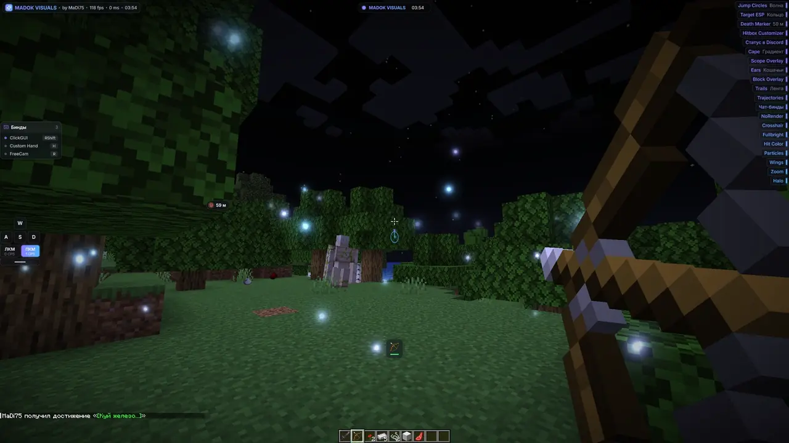

| Модуль | Что делает |
|---|---|
| Target ESP | Метка на цели: кольцо, «призраки» или маркер |
| Jump Circles | Круги на земле при прыжке |
| Trails | Шлейф за игроком и снарядами |
| Particles | Искры при ударе и светлячки вокруг |
| Crosshair | Свой прицел с хитмаркером |
| Block Overlay | Рамка вокруг блока под прицелом |
| Hitbox Customizer | Хитбоксы мобов и игроков в своём цвете |
| Hit Color | Цвет вспышки при уроне |
| Custom Hand | Позиция руки и анимации удара |
| Scope Overlay | Свой вид в подзорной трубе |
| Trajectories | Куда полетит стрела или жемчуг |
| Death Marker | Метка места последней смерти |

### HUD

Элементы двигаются мышью в редакторе HUD и прилипают к краям и друг к другу.

| Модуль | Что делает |
|---|---|
| Watermark | Логотип, FPS, пинг и время |
| ArrayList | Список включённых модулей |
| Dynamic Island | Уведомления сверху экрана |
| TargetHUD | Здоровье, броня и дистанция цели |
| Keystrokes | Нажатия WASD, мыши и CPS |
| ArmorHUD | Броня и прочность предметов |
| PotionHUD | Активные эффекты с таймером |
| Keybinds | Список биндов модулей |

### Мир

| Модуль | Что делает |
|---|---|
| Zoom | Плавный зум на клавишу |
| Fullbright | Светло везде, без факелов |
| FreeCam | Свободная камера, сквозь блоки не летает |
| NoRender | Убирает огонь на экране, тряску камеры и прочее |
| Aspect Ratio | Растянутый экран, например 4:3 |

### Косметика

Видишь только ты, другие игроки её не видят.

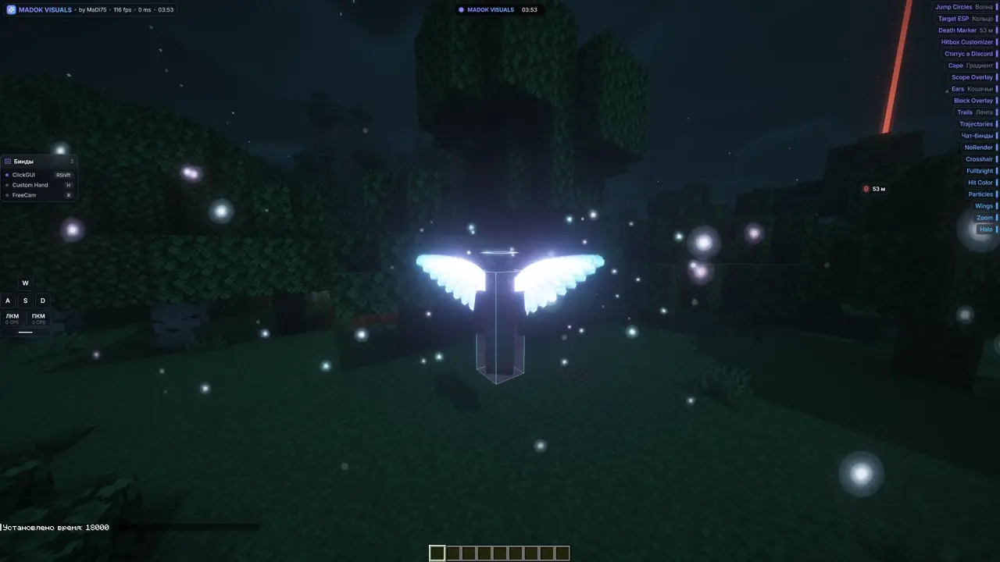

| Модуль | Что делает |
|---|---|
| Ears | Ушки на голове |
| Wings | Крылья за спиной |
| Halo | Нимб над головой |
| Cape | Свой плащ |

### Утилиты

| Модуль | Что делает |
|---|---|
| Чат-бинды | Сообщение или команда по одной клавише |
| Статус в Discord | Друзья видят в Discord, что ты играешь в MADOK VISUALS |

Ещё в клиенте есть:
- 5 цветовых тем;
- конфиги, которыми можно поделиться одним кодом;
- редактор HUD.

## Экраны

Главное меню, сервера, одиночные миры, пауза и загрузка сделаны в одном стиле с клиентом. Вся логика внутри ванильная: миры создаются и удаляются как в обычном Minecraft, сервера пингуются тем же способом.

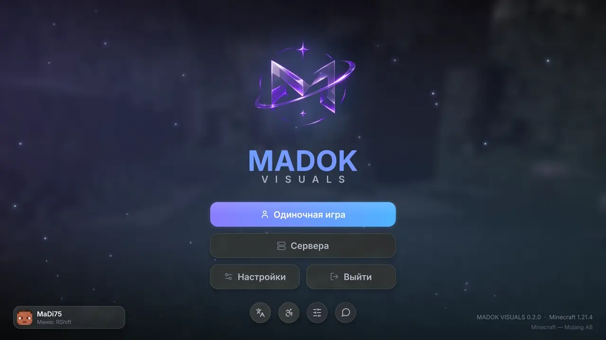
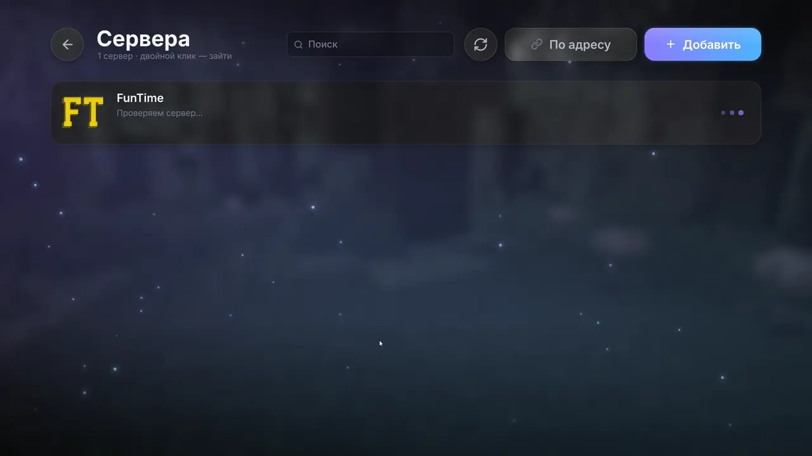

Скриншоты

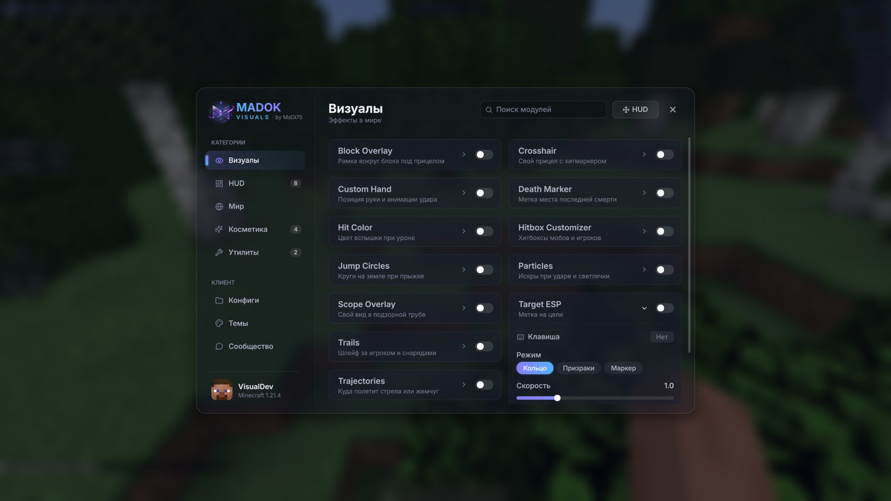
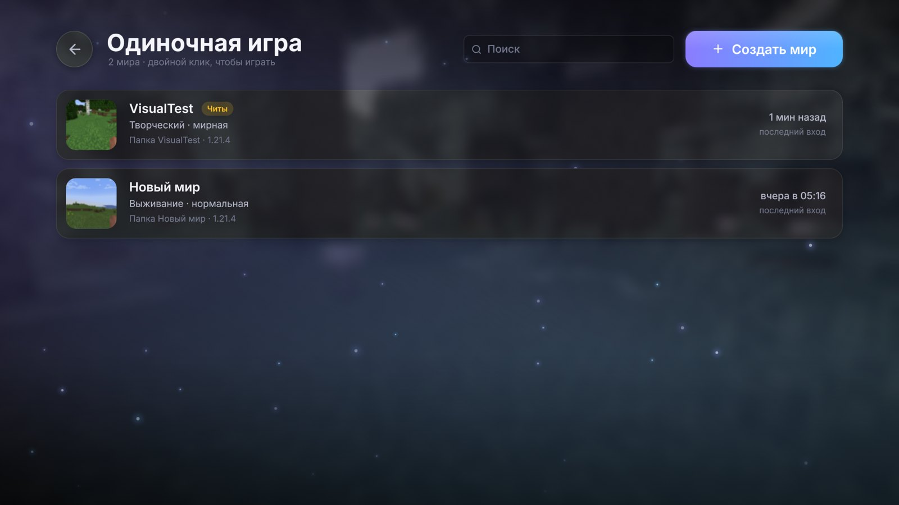
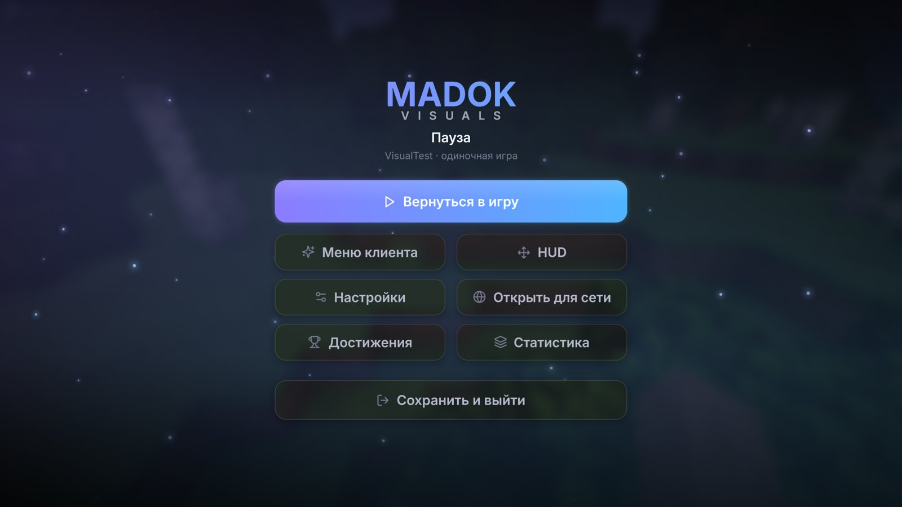
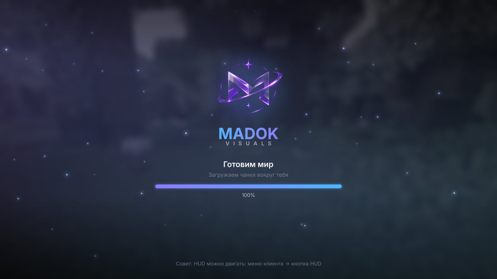

## Системные требования

- Windows 10 или 11, 64 бита;
- 3–4 ГБ оперативной памяти для игры (лаунчер выставит сам, можно поменять);
- видеокарта с поддержкой OpenGL 3.2 (подходит почти любая за последние 10 лет);
- интернет при первом запуске: лаунчер скачает около 600 МБ.

## Как установить

1. Скачай `MADOK-VISUALS-Setup-x.y.z.exe` из [последнего релиза](https://github.com/MaDi75/madok-visuals/releases/latest).
2. Запусти установщик. Ярлык появится на рабочем столе.
3. В лаунчере добавь ник и нажми «Играть».

Новые версии лаунчер находит сам: в его заголовке появляется кнопка «Обновить». Переустанавливать ничего не нужно.

## Вопросы

**Это чит?**
Нет. Клиент не даёт преимуществ: не видит сквозь стены, не стреляет за тебя, не ускоряет. Он меняет только картинку и интерфейс.

**Можно играть на серверах?**
Да. Но правила у серверов разные, поэтому если сервер запрещает любые моды, лучше прочесть правила.

**Windows пишет «Система Windows защитила ваш компьютер».**
Так бывает с установщиками без платной цифровой подписи. Нажми «Подробнее» → «Выполнить в любом случае».

**Вход через Microsoft (лицензия)?**
Появится в одном из обновлений. Сейчас можно играть под любым ником.

**Где лежат файлы игры?**
В `%APPDATA%\.visualclient`. Открыть папку можно из настроек лаунчера.

**Игра вылетела, что делать?**
Лаунчер сам покажет окно с причиной. Нажми «Скопировать отчёт» и отправь его в канал #баги в Discord.

## Поддержать проект

Хочешь поддержать MADOK VISUALS — напиши мне в Discord: **madi_228**. Идеи, баги и отзывы тоже туда или на [сервер](https://discord.gg/bKyR34QjF4).

## Изменения

**0.2.0** — первый релиз
- Меню клиента, HUD, визуалы, косметика и утилиты: 31 модуль.
- Свои экраны: главное меню, сервера, одиночные миры с созданием мира, пауза, загрузка и заставка при запуске.
- Лаунчер с автообновлением и отчётом о вылете.

---

Сделано MaDi75. © 2026 MaDi75, все права защищены.
Minecraft — товарный знак Mojang AB. Проект не связан с Mojang и Microsoft.
